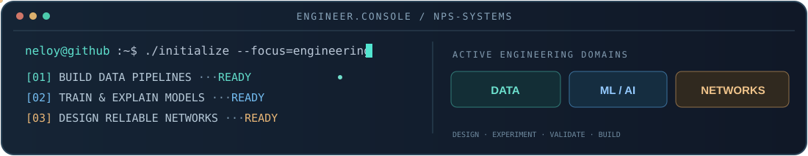
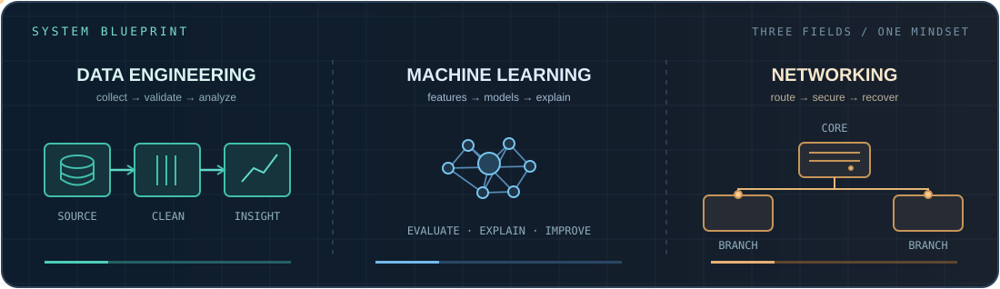
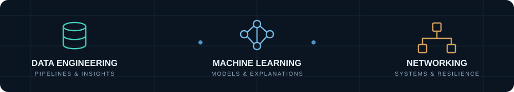

<!--
  NELOY4321 — Engineering Profile / Signature Edition
  Static hero + self-contained animated SVGs (no JavaScript, no fake counters)
  Color tokens: ink #101c2b | teal #59d5c0 | ice #71b1e0 | amber #edb87c
-->

<div align="center">


<br/>

<a href="https://www.supto.me"></a>
<a href="https://www.linkedin.com/in/neloy-pramanik-supto-b52677236/"></a>
<a href="mailto:neloybbs@gmail.com"></a>

**Computer Science & Engineering Graduate · Dhaka, Bangladesh**

### Building Intelligent Data Systems, ML Solutions, and Network Architectures



<sub>Independent engineering projects · Applied research · Reproducible experiments</sub>

</div>

---

<p align="center">
  <a href="#about-me">ABOUT</a> &nbsp;·&nbsp;
  <a href="#the-engineering-blueprint">ENGINEERING</a> &nbsp;·&nbsp;
  <a href="#featured-projects">PROJECTS</a> &nbsp;·&nbsp;
  <a href="#technical-toolkit">SKILLS</a> &nbsp;·&nbsp;
  <a href="#research--publications">RESEARCH</a> &nbsp;·&nbsp;
  <a href="#engineering-journey">JOURNEY</a> &nbsp;·&nbsp;
  <a href="#training--credentials">CREDENTIALS</a>
</p>

## About me

I am **Neloy Pramanik Supto**, a Computer Science and Engineering graduate from **Daffodil International University (2025)**. I work at the intersection of **data analytics & engineering**, **machine learning & AI**, and **computer networking**.

My interests are practical: turning messy data into repeatable workflows, testing models with meaningful validation and explainability, and designing resilient network infrastructure in simulated enterprise environments. I enjoy the entire technical process—from asking the right question to documenting and validating a working solution.

> **My approach:** Build it. Measure it. Explain it. Improve it.

**A quick snapshot**

- 🗂️ **Data:** collection, validation, ETL, exploratory analysis and structured business data.
- 🧠 **ML & AI:** supervised learning, NLP, transformers, interpretable ML and research experiments.
- 🌐 **Networking:** Cisco/MikroTik concepts, multi-area routing, segmentation, redundancy and monitoring.
- 🔬 **Research:** climate-data reconstruction, sleep-health analysis and Bengali-language NLP.
- 📍 **Based in:** Dhaka, Bangladesh · Open to collaboration on meaningful engineering work.

## The engineering blueprint

<div align="center">
  
</div>

<table>
<tr>
<td width="33%" valign="top">
<b>01 — DATA SYSTEMS</b><br/>
<sub>Reliable input → trustworthy output</sub>
<p>Python, SQL, cleaning, feature engineering, pipelines, quality checks, analytics and reproducible datasets.</p>
</td>
<td width="33%" valign="top">
<b>02 — INTELLIGENT MODELS</b><br/>
<sub>Learning → evaluation → explanation</sub>
<p>scikit-learn, XGBoost, LightGBM, PyTorch, transformers, rigorous splitting, SHAP and LIME.</p>
</td>
<td width="34%" valign="top">
<b>03 — CONNECTED INFRASTRUCTURE</b><br/>
<sub>Connectivity → security → resilience</sub>
<p>Network design, OSPF, VLANs, VRRP, NAT, stateful firewalls, SSH and monitoring labs.</p>
</td>
</tr>
</table>

## Featured projects

<div align="center">

</div>

<!-- Each feature links to its actual repository. No invented demo deployments. -->
<table>
<tr>
<td width="50%" valign="top">
<sub>01 / NETWORK ARCHITECTURE</sub>
<h3><a href="https://github.com/Neloy4321/Enterprise-Multi-Branch-Network-with-High-Availability">Enterprise Multi-Branch Network</a></h3>
<p>High-availability enterprise topology designed and validated in an <b>EVE-NG simulated lab</b> with MikroTik RouterOS v7.</p>
<p><b>Inside:</b> HQ + 2 branches · Multi-area OSPF · VLAN segmentation · VRRP · DHCP relay · NAT · Firewall · Syslog/NTP.</p>
<a href="https://github.com/Neloy4321/Enterprise-Multi-Branch-Network-with-High-Availability"><b>Explore architecture →</b></a>
</td>
<td width="50%" valign="top">
<sub>02 / END-TO-END MACHINE LEARNING</sub>
<h3><a href="https://github.com/Neloy4321/END-to-END-ML-Project">Sleep Health ML System</a></h3>
<p>Modular ML prediction pipeline from data ingestion and validation through feature processing, inference and application delivery.</p>
<p><b>Inside:</b> scikit-learn · FastAPI · MongoDB · Docker · AWS EC2/ECR · GitHub Actions CI/CD workflow.</p>
<a href="https://github.com/Neloy4321/END-to-END-ML-Project"><b>Explore ML pipeline →</b></a>
</td>
</tr>
<tr>
<td width="50%" valign="top">
<sub>03 / DATA ENGINEERING &amp; AUTOMATION</sub>
<h3><a href="https://github.com/Neloy4321/Enterprise-Geo-Business-Discovery-Data-Collection-Pipeline">Geo-Business Discovery Pipeline</a></h3>
<p>A modular Node.js and Playwright workflow to collect and transform public location-based business information into structured datasets.</p>
<p><b>Inside:</b> 10,000+ records in project testing · batching · extraction · retries · deduplication · CSV export.</p>
<a href="https://github.com/Neloy4321/Enterprise-Geo-Business-Discovery-Data-Collection-Pipeline"><b>Explore data pipeline →</b></a>
</td>
<td width="50%" valign="top">
<sub>04 / CLIMATE DATA SCIENCE RESEARCH</sub>
<h3><a href="https://github.com/Neloy4321/BD-AgroClim">BD-AgroClim</a></h3>
<p>Reanalysis bias evaluation and ML-assisted agro-climatic data reconstruction across Bangladesh, with strict spatial validation.</p>
<p><b>Inside:</b> 36 BMD stations · NASA POWER + ERA5-Land · 2000–2023 validation · LightGBM · LOSO · SHAP.</p>
<a href="https://github.com/Neloy4321/BD-AgroClim"><b>Explore research workflow →</b></a>
</td>
</tr>
<tr>
<td width="50%" valign="top">
<sub>05 / NLP, TRANSFORMERS &amp; XAI</sub>
<h3><a href="https://github.com/Neloy4321/Bengali-fakenews-hatespeech-detection">Bengali Fake News &amp; Hate Speech</a></h3>
<p>Two Bengali text-classification tasks, with transformer model comparisons, statistical evaluation and explainability.</p>
<p><b>Inside:</b> BanglaBERT · mBERT · ~95k news samples · ~50k comments · SHAP / LIME.</p>
<a href="https://github.com/Neloy4321/Bengali-fakenews-hatespeech-detection"><b>Explore NLP experiments →</b></a>
</td>
<td width="50%" valign="top">
<sub>06 / INTERPRETABLE HEALTH ANALYTICS</sub>
<h3><a href="https://github.com/Neloy4321/Explainable-Sleep-Health">Explainable Sleep Health</a></h3>
<p>Research-oriented sleep-health modeling focused on interpretable predictions, feature contributions and behavioral recommendations.</p>
<p><b>Inside:</b> tabular data · CatBoost / XGBoost · SHAP · feature engineering · individualized explanations.</p>
<a href="https://github.com/Neloy4321/Explainable-Sleep-Health"><b>Explore explainable ML →</b></a>
</td>
</tr>
</table>

### Evidence from the work

<table>
<tr>
<td align="center" width="33%">
<a href="https://github.com/Neloy4321/Enterprise-Multi-Branch-Network-with-High-Availability"></a><br/>
<sub>Enterprise network topology</sub>
</td>
<td align="center" width="33%">
<a href="https://github.com/Neloy4321/BD-AgroClim"></a><br/>
<sub>Explainable climate ML</sub>
</td>
<td align="center" width="34%">
<a href="https://github.com/Neloy4321/Bengali-fakenews-hatespeech-detection"></a><br/>
<sub>Classification evaluation</sub>
</td>
</tr>
</table>

<details>
<summary><b>Explore the implementation details &amp; research methods</b></summary>
<br/>
<ul>
<li><b>Enterprise networking:</b> Area 0 core with Areas 10/20 for the branch design; redundant gateways and layered departmental isolation, all within an emulated lab.</li>
<li><b>ML engineering:</b> separate data ingestion, preprocessing, model training, inference and container/deployment components for more consistent workflows.</li>
<li><b>Business data:</b> staged URL collection, duplicate filtering, parallel extraction and structured CSV output, with manual quality checks for collected fields.</li>
<li><b>Climate research:</b> validation against reference stations, leave-one-station-out evaluation and interpretable residual correction. Results depend on the study's validation design.</li>
<li><b>Bengali NLP:</b> transformer model comparison, class-level metrics, significance checks and explanation-oriented evaluation.</li>
<li><b>Healthcare analytics:</b> interpretable exploratory models and recommendations. This is research work, <b>not</b> a clinically validated diagnostic system.</li>
</ul>
</details>

## Technical toolkit

<div align="center">

</div>

| Data analytics & engineering | Machine learning & AI | Networking & infrastructure |
| :--- | :--- | :--- |
| Python, pandas, NumPy | scikit-learn, XGBoost, LightGBM | MikroTik RouterOS v7, Cisco IOS |
| SQL, Excel, Power BI | PyTorch, TensorFlow, Keras | EVE-NG, Packet Tracer |
| EDA, ETL, data validation | NLP, BanglaBERT, mBERT | OSPF, VLANs, inter-VLAN routing |
| Data pipelines, automation | SHAP, LIME, Optuna | VRRP, NAT, ACLs, Syslog |
| Node.js, Playwright, CSV | CNN, LSTM, model evaluation | SSH, DHCP, network troubleshooting |

<details>
<summary><b>Additional tooling and engineering workflow</b></summary>
<br/>
Docker · GitHub Actions · Git · Linux · Jupyter Notebook · MongoDB · AWS EC2 / ECR · FastAPI · Matplotlib · Statistics · Reproducibility documentation
</details>

## Research & publications

I am interested in **research that remains useful after the notebook finishes**: clear assumptions, verifiable experiments, explainability and reproducible outputs.

| Research work | Status | Access |
| :--- | :--- | :--- |
| Addressing Behavioral Patterns of Late Sleepers Using a Supervised Learning Approach | **Published conference proceedings (2026)** | [Paper / DOI](https://doi.org/10.2991/978-94-6239-664-7_24) |
| An Explainable Machine Learning Framework for Personalized Sleep Health Assessment and Behavioral Recommendations | **Journal acceptance (Sep 2026); journal article not published** | [Available preprint](https://doi.org/10.2139/ssrn.5936725) |
| Hybrid CNN–LSTM Framework for Long-Term Solar Irradiance Prediction over Bangladesh | **SSRN preprint** | [Preprint / DOI](https://doi.org/10.2139/ssrn.5928559) |
| BD-AgroClim: Machine-learning correction of reanalysis data against Bangladesh station observations | **Reproducible research repository** | [Code & figures](https://github.com/Neloy4321/BD-AgroClim) |

**Research interests:** Explainable AI · Applied ML · Spatial and temporal modeling · Bengali NLP · Climate analytics · Responsible evaluation.

## Engineering journey

<table>
<tr><td width="28%"><b>2021 — 2025</b></td><td><b>BSc in Computer Science &amp; Engineering</b><br/>Daffodil International University, Bangladesh. Foundations in algorithms, data, ML/AI, databases, networking and systems.</td></tr>
<tr><td><b>2025 — Present</b></td><td><b>Applied research &amp; project engineering</b><br/>Sleep-health ML, Bengali NLP, climate-data reconstruction, business-data pipelines and enterprise-network simulation.</td></tr>
<tr><td><b>Mar 2026 — Present</b></td><td><b>Data Engineering Associate (part-time / remote)</b><br/>Red Digital Marketing Group — data acquisition, cleaning, transformation and validation, as listed on my portfolio.</td></tr>
</table>

## Training & credentials

<table>
<tr>
<td width="50%"><b>Data Engineering — IBM / Coursera</b><br/><sub>Introduction to Data Engineering · 2026</sub><br/><a href="https://drive.google.com/file/d/1Usbqs1HAvvzOC1cH_jk0MhsL617aC56e/view?usp=sharing">Certificate evidence ↗</a></td>
<td width="50%"><b>Networking Basics — Cisco Networking Academy</b><br/><sub>Course completion · 2026</sub><br/><a href="https://drive.google.com/file/d/1GE2BmFMVSMQ7716tVxrLZGleh3ZbrVQ8/view?usp=sharing">Certificate evidence ↗</a></td>
</tr>
<tr>
<td><b>CCNA &amp; MTCNA — Creative IT Institute</b><br/><sub>Training course completion, not a vendor exam certification</sub><br/><a href="https://drive.google.com/file/d/1DM5PuRpSuabGNLx9FeMF_WCS-CzuFfnR/view?usp=sharing">Training evidence ↗</a></td>
<td><b>Machine Learning Using Python — Simplilearn</b><br/><sub>Course completion · 2026</sub><br/><a href="https://drive.google.com/file/d/1iUjasdbf6T8Oq_X3cGu3eENpYBGinol-/view?usp=sharing">Certificate evidence ↗</a></td>
</tr>
</table>

## The way I build

```text
DEFINE THE QUESTION
       |
       +--> DATA      Acquire -> Validate -> Transform -> Analyze
       |
       +--> ML        Prepare -> Train -> Evaluate -> Explain
       |
       +--> NETWORK   Design -> Configure -> Test -> Observe
       |
       v
  DOCUMENT THE EVIDENCE
       |
       v
  IMPROVE AND ITERATE
```

### Current focus

- Engineering repeatable data workflows and clear documentation.
- Strengthening ML evaluation, deployment practices and explanation methods.
- Building advanced network labs with routing, security and high availability.
- Publishing projects with reproducible methods and honest scope statements.

---

<div align="center">

**LET'S CONNECT SYSTEMS, DATA & IDEAS**



<a href="https://www.supto.me"><b>Portfolio</b></a> &nbsp;•&nbsp;
<a href="https://www.linkedin.com/in/neloy-pramanik-supto-b52677236/"><b>LinkedIn</b></a> &nbsp;•&nbsp;
<a href="mailto:neloybbs@gmail.com"><b>Email</b></a> &nbsp;•&nbsp;
<a href="https://orcid.org/0009-0001-5172-870X"><b>ORCID</b></a>

<br/><sub>Designed for clarity, motion and actual engineering evidence — not invented statistics.</sub>

</div>
