

  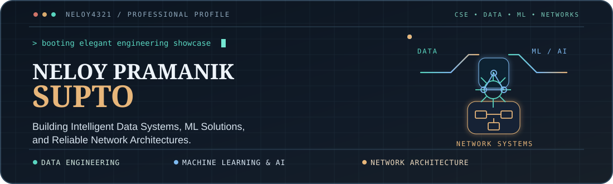
   
  
  
  
  
   
  <b>CSE Graduate · Dhaka, Bangladesh</b> | Data Engineering · Machine Learning & AI · Computer Networking

---

<a href="#about-direction">ABOUT</a> &nbsp;•&nbsp; <a href="#three-engineering-disciplines">DISCIPLINES</a> &nbsp;•&nbsp; <a href="#featured-engineering-work">PROJECTS</a> &nbsp;•&nbsp; <a href="#github-statistics">STATS</a> &nbsp;•&nbsp; <a href="#technical-toolkit">TOOLKIT</a> &nbsp;•&nbsp; <a href="#research-publications">RESEARCH</a> &nbsp;•&nbsp; <a href="#journey-credentials">JOURNEY</a> &nbsp;•&nbsp; <a href="#connect">CONNECT</a>

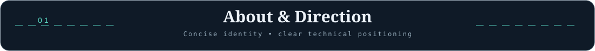

I’m **Neloy Pramanik Supto**, a **Computer Science & Engineering graduate from Daffodil International University (2025)**. My profile focuses on three balanced technical directions: **data systems**, **machine learning & AI**, and **computer networking**.

I enjoy building practical, documented work—from data collection and transformation workflows, to end-to-end machine learning systems, to network labs designed for reliability and failover.

> **Working style:** define a meaningful problem → design the method → implement → validate → document clearly.

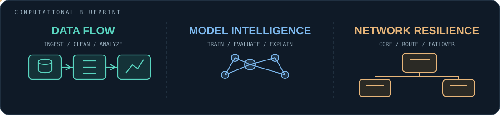

| Data & Analytics | ML & AI | Network Engineering |
| :--- | :--- | :--- |
| Python, pandas, SQL, structured workflows and automation | scikit-learn, XGBoost, LightGBM, NLP and explainability | MikroTik and Cisco concepts, routing, segmentation and HA labs |
| **Goal:** reliable data | **Goal:** understandable models | **Goal:** resilient systems |

<b>EXPLORE ENGINEERING</b> · Three focused case studies with architecture, implementation and evidence

  <a href="docs/case-studies/DATA_PIPELINE.md">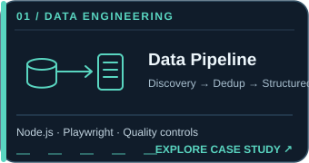</a>
  <a href="docs/case-studies/ML_SYSTEM.md">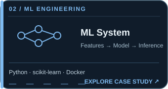</a>
  <a href="docs/case-studies/NETWORK_ARCHITECTURE.md">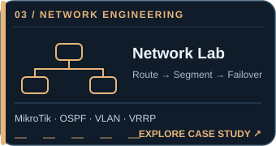</a>

<a href="https://github.com/Neloy4321/END-to-END-ML-Project">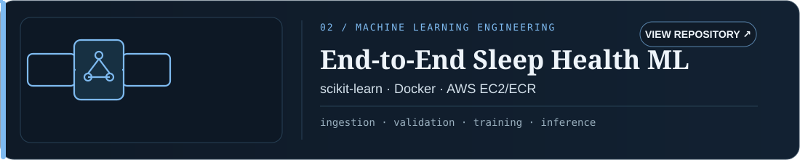</a>

<a href="https://github.com/Neloy4321/Enterprise-Geo-Business-Discovery-Data-Collection-Pipeline">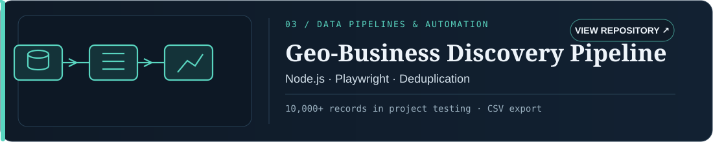</a>

<a href="https://github.com/Neloy4321/BD-AgroClim">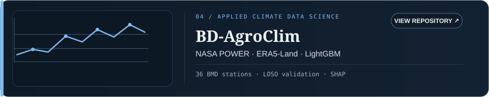</a>

<a href="https://github.com/Neloy4321/Explainable-Sleep-Health">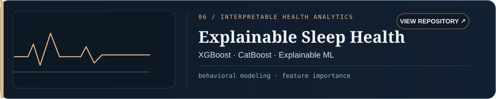</a>

<a href="docs/PROJECT_ATLAS.md"><b>Explore the Complete Project Atlas → All 12 Public Repositories</b></a>

<b>Project evidence and scope notes</b>

- **Enterprise Multi-Branch Network:** EVE-NG simulation with MikroTik RouterOS. This is a lab project, not a live production deployment.
- **Geo-Business Discovery Pipeline:** repository notes mention **10,000+ records in project testing**.
- **BD-AgroClim:** evaluation against **36 BMD stations**, including **leave-one-station-out** validation and SHAP analysis.
- **Sleep-health projects:** research and engineering work; not a clinically validated medical diagnostic tool.

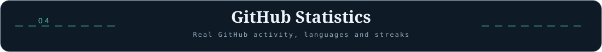

  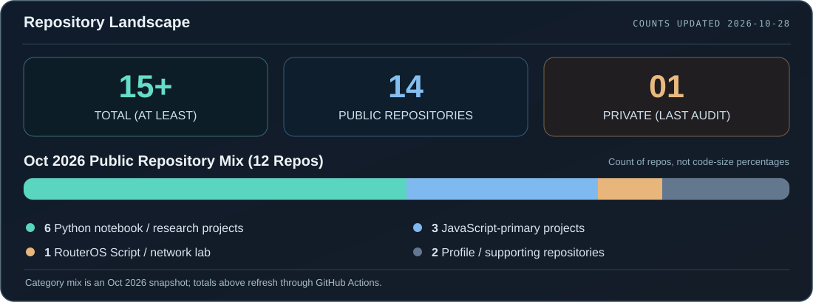

<b>Languages and technologies reflected in public repository source:</b> 
<code>Python</code> &nbsp; <code>JavaScript</code> &nbsp; <code>HTML</code> &nbsp; <code>CSS</code> &nbsp; <code>RouterOS Script</code> &nbsp; <code>YAML / JSON configuration</code>

The breakdown is based on all 12 public repositories, audited in October 2026. One private repository is counted but not identified. Notebook-heavy projects contain Python code; Jupyter Notebook's byte-based share is not a coding-skill percentage.

  <h3>Live GitHub Activity</h3>
  
  

Activity metrics are generated by external GitHub statistics services and may differ from GitHub's own contribution calendar or update at different times.

<b>More repositories included in the audit</b>

 

Beyond the six featured engineering projects above, the repository audit also includes:

<ul>
  <li><a href="https://github.com/Neloy4321/Agenting-AI">Agenting-AI</a> — Python notebook-based autonomous agent research</li>
  <li><a href="https://github.com/Neloy4321/freight-rate-ml-assessment">Freight Rate ML Assessment</a> — forecasting and model evaluation with Python</li>
  <li><a href="https://github.com/Neloy4321/CCK">CCK</a> — JavaScript / React / Node.js application</li>
  <li><a href="https://github.com/Neloy4321/Quiz_App">Quiz App</a> — JavaScript / HTML / CSS application</li>
  <li><a href="https://github.com/Neloy4321/Neloy4321.github.io">Neloy4321.github.io</a> — website support repository</li>
  <li><a href="https://github.com/Neloy4321/Neloy4321">Neloy4321</a> — this GitHub profile repository</li>
</ul>

The private repository is not linked or individually identified.

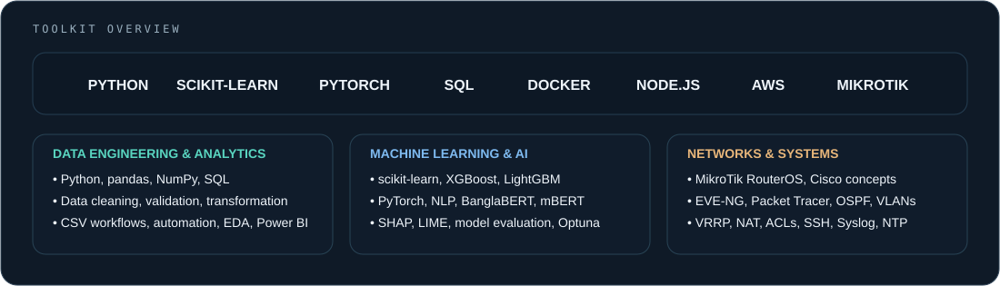

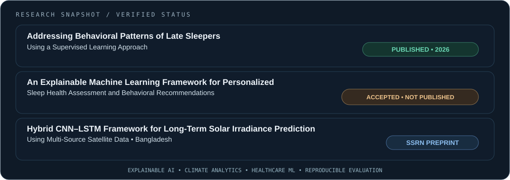

<a href="https://doi.org/10.2991/978-94-6239-664-7_24"><b>Conference Paper DOI</b></a> &nbsp;•&nbsp;
<a href="https://doi.org/10.2139/ssrn.5936725"><b>Sleep Health Preprint</b></a> &nbsp;•&nbsp;
<a href="https://doi.org/10.2139/ssrn.5928559"><b>Solar Irradiance Preprint</b></a> &nbsp;•&nbsp;
<a href="https://github.com/Neloy4321/BD-AgroClim"><b>BD-AgroClim Repository</b></a>

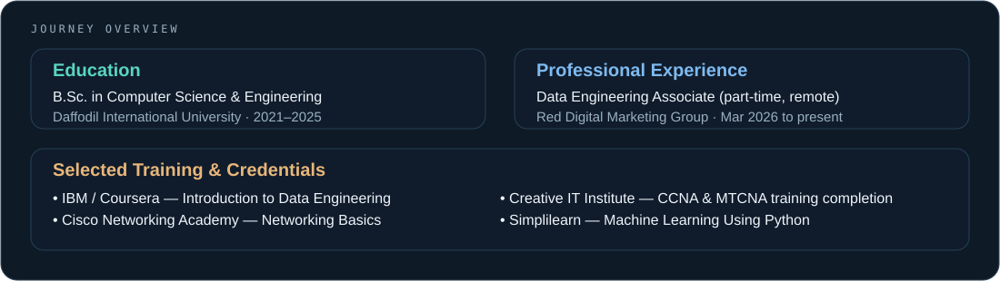

<a href="https://drive.google.com/file/d/1Usbqs1HAvvzOC1cH_jk0MhsL617aC56e/view?usp=sharing"><b>IBM / Coursera</b></a> &nbsp;•&nbsp;
<a href="https://drive.google.com/file/d/1GE2BmFMVSMQ7716tVxrLZGleh3ZbrVQ8/view?usp=sharing"><b>Cisco Networking Academy</b></a> &nbsp;•&nbsp;
<a href="https://drive.google.com/file/d/1DM5PuRpSuabGNLx9FeMF_WCS-CzuFfnR/view?usp=sharing"><b>Creative IT Training</b></a> &nbsp;•&nbsp;
<a href="https://drive.google.com/file/d/1iUjasdbf6T8Oq_X3cGu3eENpYBGinol-/view?usp=sharing"><b>Simplilearn ML</b></a>

<a href="docs/CAREER_HUB.md"><b>View Role-Specific CVs & Collaboration Opportunities →</b></a>

<a href="https://www.supto.me"><b>Portfolio</b></a> &nbsp;•&nbsp;
<a href="https://www.linkedin.com/in/neloy-pramanik-supto-b52677236/"><b>LinkedIn</b></a> &nbsp;•&nbsp;
<a href="mailto:neloybbs@gmail.com"><b>Email</b></a> &nbsp;•&nbsp;
<a href="https://orcid.org/0009-0001-5172-870X"><b>ORCID</b></a>

