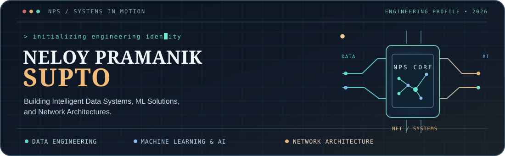
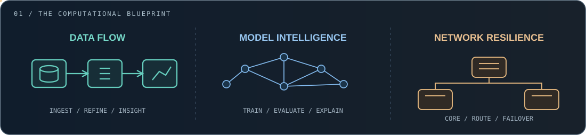
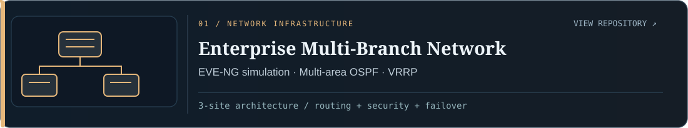
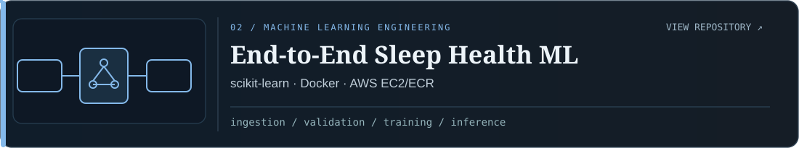
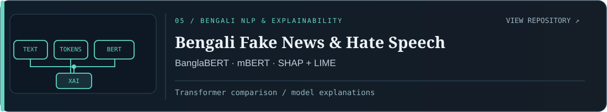
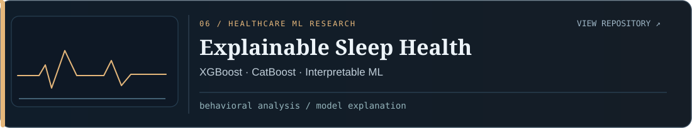

<!-- NPS / Systems in Motion — Custom GitHub Profile | no stock banner, no scripted UI -->
<div align="center">
  
  <p>
    <a href="https://www.supto.me"></a>
    <a href="https://www.linkedin.com/in/neloy-pramanik-supto-b52677236/"></a>
    <a href="mailto:neloybbs@gmail.com"></a>
    <a href="https://orcid.org/0009-0001-5172-870X"></a>
  </p>
  <sub><b>CSE Graduate · Dhaka, Bangladesh</b> | Data Engineering · Machine Learning & AI · Computer Networking</sub>
</div>

---

<div align="center">
<a href="#01--about--direction">ABOUT</a> &nbsp;·&nbsp; <a href="#02--three-engineering-disciplines">DISCIPLINES</a> &nbsp;·&nbsp; <a href="#03--featured-engineering-work">PROJECTS</a> &nbsp;·&nbsp; <a href="#04--technical-toolkit">TOOLKIT</a> &nbsp;·&nbsp; <a href="#05--research--publications">RESEARCH</a> &nbsp;·&nbsp; <a href="#06--journey--credentials">JOURNEY</a> &nbsp;·&nbsp; <a href="#07--connect">CONNECT</a>
</div>

## 01 / About & Direction

I'm **Neloy Pramanik Supto**, a Computer Science & Engineering graduate from **Daffodil International University (2025)**. I focus equally on three technical areas:

**Data systems** that turn unstructured information into reliable datasets; **machine learning** that can be evaluated and explained; and **computer networks** designed for connectivity, security and resilience.

My portfolio brings together **implemented projects**, **applied research** and **documented experiments**—from automated data collection and an end-to-end sleep-health ML workflow to a multi-site networking lab.

> **How I work:** Frame a real problem → design a method → implement → validate → document → improve.

## 02 / Three Engineering Disciplines

<div align="center">

</div>

| 01 — Data & Analytics | 02 — ML & AI | 03 — Network Engineering |
| :--- | :--- | :--- |
| Python, pandas, SQL, data cleaning, quality control and automated pipelines | scikit-learn, XGBoost, LightGBM, NLP, explainable AI and careful evaluation | Cisco and MikroTik concepts, OSPF, VLANs, VRRP, firewalling, network labs |
| **Goal:** trustworthy data | **Goal:** understandable predictions | **Goal:** reliable systems |

## 03 / Featured Engineering Work

<div align="center"></div>

<div align="center"><a href="https://github.com/Neloy4321/Enterprise-Multi-Branch-Network-with-High-Availability"></a></div>
A headquarters and two branches, with routing, VLAN isolation, gateway redundancy and monitoring in an emulated network. **[Repository ↗](https://github.com/Neloy4321/Enterprise-Multi-Branch-Network-with-High-Availability)**

<div align="center"><a href="https://github.com/Neloy4321/END-to-END-ML-Project"></a></div>
An ingestion-to-prediction workflow with containerization, deployment-oriented components and documented CI/CD architecture. **[Repository ↗](https://github.com/Neloy4321/END-to-END-ML-Project)**

<div align="center"><a href="https://github.com/Neloy4321/Enterprise-Geo-Business-Discovery-Data-Collection-Pipeline"></a></div>
Batch-oriented collection and transformation of public business information into structured datasets. **[Repository ↗](https://github.com/Neloy4321/Enterprise-Geo-Business-Discovery-Data-Collection-Pipeline)**

<div align="center"><a href="https://github.com/Neloy4321/BD-AgroClim"></a></div>
Bias correction and validation of agro-climatic reanalysis data with spatially withheld evaluation. **[Repository ↗](https://github.com/Neloy4321/BD-AgroClim)**

<div align="center"><a href="https://github.com/Neloy4321/Bengali-fakenews-hatespeech-detection"></a></div>
Classification and explainability analysis across Bengali news and hate-speech tasks. **[Repository ↗](https://github.com/Neloy4321/Bengali-fakenews-hatespeech-detection)**

<div align="center"><a href="https://github.com/Neloy4321/Explainable-Sleep-Health"></a></div>
Sleep and lifestyle-data modeling focused on interpretable predictions and behavioral recommendations. **[Repository ↗](https://github.com/Neloy4321/Explainable-Sleep-Health)**


<details>
<summary><b>Explore verified results, diagrams and project evidence</b></summary>

The illustrations above are **custom conceptual diagrams**, not screenshots of running software. The following files are **real evidence from the project repositories**.

| Enterprise topology | Climate XAI results | Bengali NLP evaluation |
| :---: | :---: | :---: |
| [](https://github.com/Neloy4321/Enterprise-Multi-Branch-Network-with-High-Availability) | [](https://github.com/Neloy4321/BD-AgroClim) | [](https://github.com/Neloy4321/Bengali-fakenews-hatespeech-detection) |

**A few documented highlights:**

- **Enterprise network:** HQ and two simulated branches, multi-area OSPF, VLAN segmentation, VRRP and monitoring. This is an **EVE-NG lab**, not deployed production infrastructure.
- **Geo-business pipeline:** tested on **10,000+ business records** across US and UK regions, as described in the repository.
- **BD-AgroClim:** NASA POWER and ERA5-Land evaluated against **36 BMD stations**, with **leave-one-station-out** validation and SHAP analysis.
- **Bengali NLP:** BanglaBERT and multilingual BERT, classifier evaluation and SHAP/LIME explanations.
- **Sleep-health ML:** research and software engineering work, **not a clinically validated medical diagnostic tool**.

</details>

## 04 / Technical Toolkit

<div align="center">

</div>

| Data engineering & analytics | ML, AI & research | Networks & systems |
| :--- | :--- | :--- |
| Python · pandas · NumPy · SQL | scikit-learn · XGBoost · LightGBM | MikroTik RouterOS · Cisco IOS |
| Power BI · Excel · EDA | PyTorch · TensorFlow · Keras | EVE-NG · Cisco Packet Tracer |
| Data cleaning · transformation | NLP · BanglaBERT · mBERT | OSPF · VLANs · VRRP |
| Node.js · Playwright · CSV | SHAP · LIME · Optuna | NAT · ACLs · SSH · Syslog |

<details>
<summary><b>Methods, infrastructure and development tooling</b></summary>

**Data:** collection, normalization, feature engineering, statistical analysis, missing-value handling, reproducible ETL-style data workflows.

**ML & research:** supervised learning, imbalanced classification, validation design, cross-validation, explainability, model comparison and interpreting error.

**Networks:** network addressing, routing, switching, segmentation, firewalls, DHCP, SSH hardening, gateway redundancy, logging and monitoring.

**Additional tools:** Docker · GitHub Actions · MongoDB · FastAPI · AWS EC2/ECR · Linux · Git · Jupyter Notebook.

</details>

## 05 / Research & Publications

**Research themes:** Explainable ML, healthcare analytics, climate data, spatiotemporal modeling, Bengali NLP and evaluation methodology.

| Work | Verified status | Link |
| :--- | :--- | :--- |
| Addressing Behavioral Patterns of Late Sleepers Using a Supervised Learning Approach | **Published conference proceedings (2026)** | [DOI ↗](https://doi.org/10.2991/978-94-6239-664-7_24) |
| An Explainable Machine Learning Framework for Personalized Sleep Health Assessment and Behavioral Recommendations | **Accepted Sep 2026; journal publication not completed** | [Available preprint ↗](https://doi.org/10.2139/ssrn.5936725) |
| Hybrid CNN–LSTM Framework for Long-Term Solar Irradiance Prediction over Bangladesh | **SSRN preprint** | [Preprint ↗](https://doi.org/10.2139/ssrn.5928559) |
| BD-AgroClim climate data reconstruction | **Public research code, figures and documentation** | [Research repository ↗](https://github.com/Neloy4321/BD-AgroClim) |

<details>
<summary><b>How I approach reproducible research</b></summary>

```text
Research question
      |
Data collection & provenance
      |
Cleaning & validation
      |
Baseline and careful train/test design
      |
ML / deep-learning experiments
      |
Evaluation, error analysis & explainability
      |
Documented results and limitations
```

I try to distinguish published results, preprints, accepted-but-unpublished work and ongoing experiments rather than presenting every manuscript as a journal publication.

</details>

## 06 / Journey & Credentials

**Education — 2021 to 2025**  
B.Sc. in Computer Science & Engineering, Daffodil International University, Bangladesh.

**Professional experience — Mar 2026 to present**  
Data Engineering Associate (part-time, remote), Red Digital Marketing Group. Work listed in my portfolio includes data acquisition, cleaning, transformation, validation and analytics support.

**Selected training**

- [IBM / Coursera — Introduction to Data Engineering](https://drive.google.com/file/d/1Usbqs1HAvvzOC1cH_jk0MhsL617aC56e/view?usp=sharing)
- [Cisco Networking Academy — Networking Basics](https://drive.google.com/file/d/1GE2BmFMVSMQ7716tVxrLZGleh3ZbrVQ8/view?usp=sharing)
- [Creative IT Institute — CCNA & MTCNA training completion](https://drive.google.com/file/d/1DM5PuRpSuabGNLx9FeMF_WCS-CzuFfnR/view?usp=sharing) (training, **not** Cisco/MikroTik vendor exam certification)
- [Simplilearn — Machine Learning Using Python](https://drive.google.com/file/d/1iUjasdbf6T8Oq_X3cGu3eENpYBGinol-/view?usp=sharing)

**What I'm building toward:** stronger end-to-end data systems, more reliable ML engineering workflows and increasingly realistic networking labs, with clear documentation in each repository.

## 07 / Connect

<div align="center">

**CODE WITH PURPOSE · RESEARCH WITH RIGOR · SYSTEMS THAT CONNECT**

[**Portfolio — supto.me**](https://www.supto.me) &nbsp; · &nbsp; [**LinkedIn**](https://www.linkedin.com/in/neloy-pramanik-supto-b52677236/) &nbsp; · &nbsp; [**Email**](mailto:neloybbs@gmail.com) &nbsp; · &nbsp; [**ORCID**](https://orcid.org/0009-0001-5172-870X)

<sub>Original engineering visuals · Self-contained SVG motion · No stock banners · No fabricated stats</sub>

</div>
